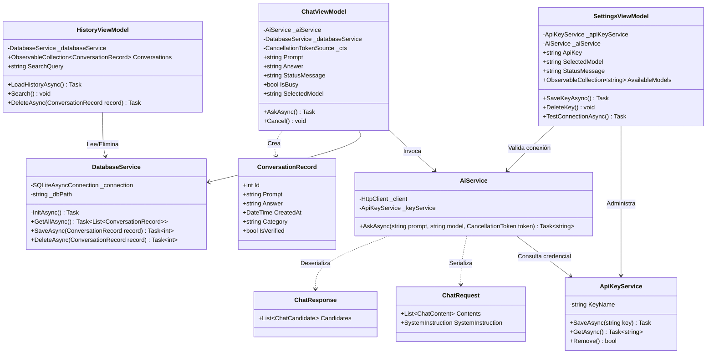

# Documentación Integral y Entregables Técnicos
## Proyecto Final: Asistente Académico Móvil con .NET MAUI y API REST de IA
**Institución:** Universidad de San Buenaventura  
**Asignatura:** Programación Avanzada y Aplicada (VI Semestre)  
**Autor:** Michael Yesid Castro Daza  
**Repositorio Oficial:** [github.com/mike-ki17/AsistenteIA-NET-MAUI](https://github.com/mike-ki17/AsistenteIA-NET-MAUI)  
**Plataforma de despliegue:** .NET MAUI (Windows / Android)  
**Fecha:** Octubre de 2026  

---

## Tabla de Contenido
1. [Metodología de Desarrollo](#1-metodología-de-desarrollo)
2. [Documento de Requisitos](#2-documento-de-requisitos)
3. [Arquitectura de Software y Decisiones Técnicas](#3-arquitectura-de-software-y-decisiones-técnicas)
4. [Diagrama de Clases (UML)](#4-diagrama-de-clases-uml)
5. [Especificación y Documentación del Consumo REST](#5-especificación-y-documentación-del-consumo-rest)
6. [Persistencia Local SQLite (Operaciones CRUD)](#6-persistencia-local-sqlite-operaciones-crud)
7. [Matriz de Riesgos: Seguridad, Privacidad y Uso Responsable](#7-matriz-de-riesgos-seguridad-privacidad-y-uso-responsable)
8. [Plan y Tabla de Pruebas (10 Casos)](#8-plan-y-tabla-de-pruebas-10-casos)
9. [Manual de Usuario](#9-manual-de-usuario)
10. [Manual Técnico y Guía de Despliegue](#10-manual-técnico-y-guía-de-despliegue)

---

## 1. Metodología de Desarrollo

Para el ciclo de vida del proyecto se utilizó una metodología ágil fundamentada en **Scrum** adaptada a sprints cortos de trabajo técnico:

* **Sprint 1 (Análisis y Diseño):** Definición de requisitos funcionales y no funcionales, modelado de dominio, diagramas de arquitectura y configuración de repositorio en GitHub con `.gitignore` para .NET MAUI.
* **Sprint 2 (Navegación e Interfaz de Usuario):** Implementación de navegación Shell (`AppShell.xaml`), maquetación XAML con `AppThemeBinding` (soporte tema claro/oscuro) para las vistas `HomePage`, `ChatPage`, `HistoryPage`, `DetailPage` y `SettingsPage`.
* **Sprint 3 (Integración Técnica y Consumo REST):** Implementación de MVVM (`CommunityToolkit.Mvvm`), almacenamiento seguro con `SecureStorage`, e integración asíncrona mediante `HttpClient` con el modelo generativo Google Gemini (`gemini-1.5-flash`).
* **Sprint 4 (Persistencia y Calidad):** Implementación de SQLite local (`sqlite-net-pcl`), operaciones completas de consulta y guardado automático en historial, ejecución de pruebas unitarias y de integración.
* **Sprint 5 (Documentación y Cierre):** Consolidación de manuales técnicos, compilación final y preparación de sustentación.

---

## 2. Documento de Requisitos

### 2.1 Requisitos Funcionales (RF)
* **RF01:** El sistema debe permitir al usuario ingresar preguntas o instrucciones académicas mediante un control multilinea (`Editor`).
* **RF02:** El sistema debe validar que el prompt ingresado tenga entre $5$ y $2000$ caracteres antes de despachar la petición HTTP.
* **RF03:** El sistema debe transmitir la consulta en formato JSON a través del verbo HTTP `POST` hacia la API de inteligencia artificial.
* **RF04:** La interfaz debe reflejar estados de carga (`ActivityIndicator`), mensaje de estado descriptivo, respuesta procesada y captura de errores sin interrupción abrupta de la app.
* **RF05:** Cada consulta procesada exitosamente debe almacenarse automáticamente de forma local en SQLite.
* **RF06:** El usuario debe poder listar, buscar en tiempo real mediante `SearchBar`, visualizar el detalle completo y eliminar registros del historial.
* **RF07:** La aplicación debe proveer un mensaje de sistema (*System Prompt*) académico que limite las respuestas a explicaciones directas, verídicas y concisas.
* **RF08:** La pantalla de configuración debe permitir almacenar o eliminar la clave de API sin mostrarla en texto plano (`IsPassword="True"`), utilizando almacenamiento seguro del dispositivo.
* **RF09:** La aplicación debe informar claramente advertencias de privacidad de datos personales y límites del modelo.
* **RF10:** La solución debe ejecutar y adaptarse fluidamente en Windows Machine y entornos móviles Android.

### 2.2 Requisitos No Funcionales (RNF)
* **RNF01 (Seguridad):** Las credenciales no deben estar quemadas en el código fuente ni expuestas en repositorios. Deben cifrarse en reposo mediante `SecureStorage`.
* **RNF02 (Usabilidad y Accesibilidad):** Soporte de alto contraste mediante temas Dinámicos Claro/Oscuro y tipografías legibles.
* **RNF03 (Rendimiento):** Operaciones de red y lectura a disco deben ejecutarse de forma no bloqueante (`async`/`await`) con soporte de cancelación inmediata vía `CancellationToken`.

---

## 3. Arquitectura de Software y Decisiones Técnicas

El proyecto implementa el patrón **MVVM (Model - View - ViewModel)** combinado con **Inyección de Dependencias (DI)** nativa de .NET MAUI:

```
[ Vista (XAML) ] <---> [ Data Binding / Commands ] <---> [ ViewModel ]
                                                               |
                                        +----------------------+----------------------+
                                        |                                             |
                                        v                                             v
                              [ AiService (HTTP/REST) ]                   [ DatabaseService (SQLite) ]
                                        |                                             |
                                        v                                             v
                              [ Google Gemini API ]                       [ AsistenteIA.db3 ]
```

### Decisiones Técnicas Clave
1. **Migración a Google Gemini REST API:** Se adoptó el endpoint `gemini-1.5-flash` a través de `generativelanguage.googleapis.com` debido a su alta velocidad de inferencia, disponibilidad de cuota gratuita académica y soporte de directivas de sistema nativas (`systemInstruction`).
2. **CommunityToolkit.Mvvm:** Se utilizaron generadores de código fuente (`[ObservableProperty]`, `[RelayCommand]`) reduciendo el código repetitivo (*boilerplate*) y asegurando la notificación de cambios en UI (`INotifyPropertyChanged`).
3. **Persistencia Ligera SQLite:** `sqlite-net-pcl` provee un ORM asíncrono eficiente (`SQLiteAsyncConnection`) sin requerir motores externos de base de datos.
4. **Almacenamiento Seguro:** Se implementó `Microsoft.Maui.Storage.SecureStorage` para resguardar la API Key mediante el Administrador de Credenciales en Windows y el Keystore en Android.

---

## 4. Diagrama de Clases (UML)



---

## 5. Especificación y Documentación del Consumo REST

* **Endpoint:** `POST https://generativelanguage.googleapis.com/v1beta/models/{model}:generateContent`
* **Modelo por Defecto:** `gemini-1.5-flash`
* **Cabeceras HTTP (Headers):**
  * `Content-Type: application/json`
  * `x-goog-api-key: [CLAVE_SEGURA_INGRESADA]`

### 5.1 Ejemplo de Solicitud (JSON Request Body)
```json
{
  "systemInstruction": {
    "parts": [
      {
        "text": "Eres un asistente académico. Responde de forma clara, directa y muy breve. Limita tu respuesta a un máximo de dos párrafos."
      }
    ]
  },
  "contents": [
    {
      "role": "user",
      "parts": [
        {
          "text": "Explica qué es una API REST."
        }
      ]
    }
  ]
}
```

### 5.2 Ejemplo de Respuesta Exitosa (HTTP 200 OK)
```json
{
  "candidates": [
    {
      "content": {
        "parts": [
          {
            "text": "Una API REST (Representational State Transfer) es una interfaz de programación de aplicaciones que permite la comunicación entre dos sistemas informáticos a través del protocolo HTTP. Se basa en principios como la arquitectura cliente-servidor sin estado, el uso de métodos estándar (GET, POST, PUT, DELETE) y la manipulación de recursos identificados mediante URIs, intercambiando comúnmente datos en formato JSON."
          }
        ],
        "role": "model"
      },
      "finishReason": "STOP"
    }
  ]
}
```

### 5.3 Códigos de Estado Manejados
| Código HTTP | Significado | Comportamiento en la Aplicación |
| :--- | :--- | :--- |
| **200 OK** | Petición exitosa | Muestra la respuesta en pantalla y persiste en SQLite. |
| **400 Bad Request** | Formato de solicitud inválido | Capturado en bloque `catch`, muestra mensaje descriptivo. |
| **403 / 401 Forbidden** | Credencial inválida o no autorizada | Muestra alerta solicitando verificar la clave en Configuración. |
| **404 Not Found** | Modelo o URL no encontrada | Notifica error de ruta/recurso no disponible. |
| **CancellationToken** | Cancelación manual o Timeout (60s) | Informa: *"Consulta cancelada o tiempo agotado."* |

---

## 6. Persistencia Local SQLite (Operaciones CRUD)

La entidad de datos principal reside en la base de datos `AsistenteIA.db3`:

```csharp
[Table("ConversationRecord")]
public class ConversationRecord
{
    [PrimaryKey, AutoIncrement]
    public int Id { get; set; }
    public string Prompt { get; set; } = string.Empty;
    public string Answer { get; set; } = string.Empty;
    public DateTime CreatedAt { get; set; } = DateTime.UtcNow;
    public string Category { get; set; } = "General";
    public bool IsVerified { get; set; }
}
```

### Operaciones Implementadas en `DatabaseService.cs`:
1. **Crear (Insert):** Ejecutado en `ChatViewModel.cs` tras cada respuesta exitosa de Gemini.
2. **Consultar (Read/Select):** Recuperación asíncrona mediante `_connection.Table<ConversationRecord>().OrderByDescending(x => x.CreatedAt).ToListAsync()` dentro de `HistoryViewModel.cs`.
3. **Actualizar (Update):** Permite cambiar el estado `IsVerified = true` al contrastar la respuesta.
4. **Eliminar (Delete):** Implementado con confirmación modal `DisplayAlert` en el botón lateral del `HistoryPage`.

---

## 7. Matriz de Riesgos: Seguridad, Privacidad y Uso Responsable

| Riesgo Identificado | Nivel | Impacto Potencial | Mecanismo de Control Técnico Implementado |
| :--- | :---: | :--- | :--- |
| **Exposición de API Keys** | Crítico | Fuga de cuotas, costos no autorizados, suspensión de cuenta. | Almacenamiento exclusivo en `SecureStorage` del dispositivo; exclusión total de claves en el repositorio Git; campo enmascarado (`IsPassword="True"`). |
| **Fuga de Datos Sensibles** | Alto | Filtración de datos confidenciales o personales hacia servidores de terceros. | Marco de advertencia visible y permanente en la pestaña `SettingsPage` y `HomePage` indicando no ingresar contraseñas ni datos privados. |
| **Alucinación / Error de IA** | Alto | Respuestas académicamente incorrectas o fuentes inventadas. | Inyección de System Prompt restrictivo exigiendo rigor académico; mensaje de estado que advierte verificar la información; campo `IsVerified` en SQLite. |
| **Bloqueo de Interfaz (ANR)** | Medio | Aplicación congelada mientras el modelo genera la respuesta. | Ejecución 100% asíncrona con `HttpClient.SendAsync`, enlace reactivo con `IsBusy` y botón Cancelar (`CancellationTokenSource`). |
| **Agotamiento de Tiempo** | Bajo | Esperas infinitas por fallas de conexión del usuario. | Configuración estricta de `Timeout = TimeSpan.FromSeconds(60)` en el registro del servicio HTTP. |

---

## 8. Plan y Tabla de Pruebas (10 Casos)

| ID | Caso de Prueba | Condición Inicial | Acción Realizada | Resultado Esperado | Estado |
| :---: | :--- | :--- | :--- | :--- | :---: |
| **P01** | Consulta válida con clave | Clave válida en Configuración | Enviar: *"¿Qué es MVVM?"* | Respuesta visible, estado final correcto y registro guardado. | **Pasa** |
| **P02** | Validación prompt corto | Campo de texto con 3 letras | Presionar "Consultar" | Alerta: *"La consulta es demasiado corta."* No se realiza petición REST. | **Pasa** |
| **P03** | Sin clave configurada | Almacenamiento de clave vacío | Presionar "Consultar" | Mensaje de error controlado: *"Configure la clave de la API."* | **Pasa** |
| **P04** | Clave inválida / Caducada | Clave falsa ("prueba123") | Presionar "Probar Conexión" | Captura de `HttpRequestException` mostrando error HTTP 400/403 sin colapsar. | **Pasa** |
| **P05** | Cancelación voluntaria | Consulta en progreso | Presionar botón "Cancelar" | Se activa `CancellationTokenSource`, se detiene el spinner y reporta *"Consulta cancelada"*. | **Pasa** |
| **P06** | Guardado automático SQLite | Consulta exitosa | Navegar a pestaña Historial | El registro aparece en la lista con su fecha, prompt y categoría. | **Pasa** |
| **P07** | Búsqueda en historial | 3 registros en historial | Escribir término en SearchBar | La lista se filtra en tiempo real mostrando únicamente los registros coincidentes. | **Pasa** |
| **P08** | Eliminación con confirmación | Registro visible en historial | Presionar botón de eliminar y aceptar diálogo | El elemento se remueve de SQLite y la UI se actualiza inmediatamente. | **Pasa** |
| **P09** | Persistencia al reiniciar | Consultas guardadas previamente | Cerrar la aplicación y volver a iniciarla | Los datos se cargan intactos desde el archivo local `.db3`. | **Pasa** |
| **P10** | Adaptación de Interfaz | Alternar tema del sistema | Cambiar Windows/Android a Modo Oscuro | Fondos, marcos, textos y bordes cambian de color sin errores visuales (`AppThemeBinding`). | **Pasa** |

---

## 9. Manual de Usuario

### 9.1 Inicio
Al abrir la aplicación, la pantalla de **Inicio** presenta la misión del Asistente Académico, recomendaciones éticas de uso y accesos rápidos directos a las funciones de consulta e historial.

### 9.2 Primer Paso: Configurar la Credencial
1. Diríjase a la pestaña **Configuración** en la barra inferior.
2. En el recuadro **Credenciales de API**, ingrese su clave generada en Google AI Studio. Los caracteres se mantendrán ocultos.
3. Presione el botón verde **Guardar**.
4. Presione el botón **Probar Conexión** para verificar que la clave tenga acceso válido a Gemini. El sistema reportará *"¡Conexión exitosa!"*.

### 9.3 Realizar una Consulta Académica
1. Seleccione la pestaña **Consultar**.
2. Escriba su inquietud o solicitud de investigación en el cuadro de texto.
3. Pulse **Consultar**. Mientras el modelo procesa la información se observará un indicador circular de carga.
4. Si desea detener la consulta en cualquier instante, presione **Cancelar**.
5. Al recibir la respuesta, revísela con criterio crítico contrastando con fuentes bibliográficas.

### 9.4 Consultar y Gestionar Historial
1. Seleccione la pestaña **Historial**.
2. Desplace la lista para visualizar las consultas previas ordenadas cronológicamente.
3. Utilice la **Barra de Búsqueda** superior para encontrar temas específicos por palabras clave.
4. Para descartar una entrada, presione el botón de eliminar asociado a la tarjeta y confirme la acción en el diálogo emergente.

---

## 10. Manual Técnico y Guía de Despliegue

### 10.1 Requisitos de Entorno
* **IDE:** Visual Studio 2022 Community (v17.10 o superior) con la carga de trabajo *Desarrollo de la interfaz de usuario de aplicaciones multiplataforma de .NET (.NET MAUI)*.
* **SDK:** .NET 9.0 o .NET 8.0.
* **Paquetes NuGet Requeridos:**
  * `CommunityToolkit.Mvvm` (v8.4.2)
  * `CommunityToolkit.Maui` (v9.x)
  * `sqlite-net-pcl` (v1.11.285)
  * `SQLitePCLRaw.bundle_green` (v2.1.11)

### 10.2 Procedimiento de Clonación y Compilación
```bash
# 1. Clonar el repositorio
git clone https://github.com/mike-ki17/AsistenteIA-NET-MAUI.git

# 2. Acceder al directorio
cd AsistenteIA-NET-MAUI/AsistenteIA

# 3. Restaurar dependencias
dotnet restore

# 4. Compilar en configuración Debug para Windows
dotnet build -f net9.0-windows10.0.19041.0
```

### 10.3 Limpieza previa a la entrega (Sin bin / obj)
Antes de comprimir la entrega para entrega académica, ejecute desde la raíz del proyecto para eliminar artefactos temporales:
```bash
dotnet clean
# O manualmente eliminar las carpetas /bin y /obj dentro de la carpeta del proyecto.
```